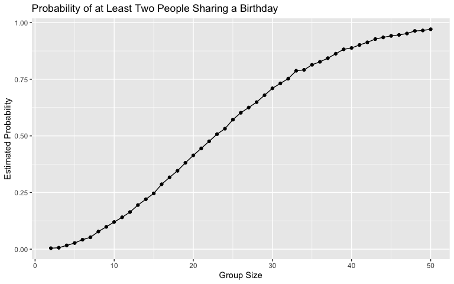

P8105 Homework 5
================
Irene Wen

### Problem 1 — Birthday Paradox Simulation

``` r
birthday_sim = function(n) {

  birthdays = sample(
    x = 1:365,
    size = n,
    replace = TRUE
  )

  shared_birthday = any(duplicated(birthdays))

  return(shared_birthday)
}
```

``` r
birthday_prob = function(n) {

  sim_results = map_lgl(
    1:10000,
    \(i) birthday_sim(n = n)
  )

  estimated_prob = mean(sim_results)

  return(estimated_prob)
}
```

``` r
birthday_df =
  tibble(group_size = 2:50) |>
  mutate(
    probability = map_dbl(group_size, birthday_prob)
  )

birthday_df |>
  knitr::kable(digits = 3)
```

| group_size | probability |
|-----------:|------------:|
|          2 |       0.004 |
|          3 |       0.006 |
|          4 |       0.016 |
|          5 |       0.027 |
|          6 |       0.042 |
|          7 |       0.052 |
|          8 |       0.078 |
|          9 |       0.098 |
|         10 |       0.120 |
|         11 |       0.141 |
|         12 |       0.164 |
|         13 |       0.195 |
|         14 |       0.220 |
|         15 |       0.246 |
|         16 |       0.286 |
|         17 |       0.317 |
|         18 |       0.346 |
|         19 |       0.381 |
|         20 |       0.414 |
|         21 |       0.445 |
|         22 |       0.476 |
|         23 |       0.508 |
|         24 |       0.532 |
|         25 |       0.572 |
|         26 |       0.602 |
|         27 |       0.625 |
|         28 |       0.649 |
|         29 |       0.679 |
|         30 |       0.710 |
|         31 |       0.732 |
|         32 |       0.753 |
|         33 |       0.787 |
|         34 |       0.791 |
|         35 |       0.814 |
|         36 |       0.827 |
|         37 |       0.843 |
|         38 |       0.863 |
|         39 |       0.882 |
|         40 |       0.888 |
|         41 |       0.901 |
|         42 |       0.913 |
|         43 |       0.927 |
|         44 |       0.935 |
|         45 |       0.942 |
|         46 |       0.946 |
|         47 |       0.952 |
|         48 |       0.963 |
|         49 |       0.965 |
|         50 |       0.971 |

``` r
birthday_df |>
  ggplot(aes(x = group_size, y = probability)) +
  geom_line() +
  geom_point() +
  labs(
    title = "Probability of at Least Two People Sharing a Birthday",
    x = "Group Size",
    y = "Estimated Probability"
  )
```

<!-- -->

The estimated probability that at least two people share a birthday
generally increases with group size. The probability is only 0.25% for a
group of two people but rises to 50.4% for a group of 23 people and
reaches 97.1% for a group of 50 people. Although these results may
initially seem surprising, the number of possible pairs increases
rapidly as group size grows, making a shared birthday increasingly
likely.
