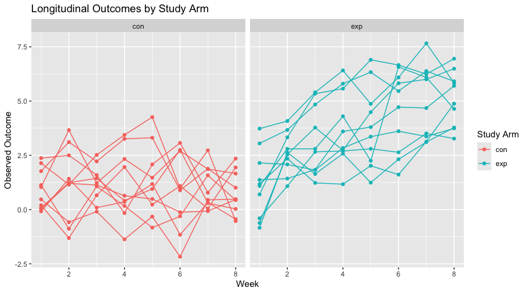
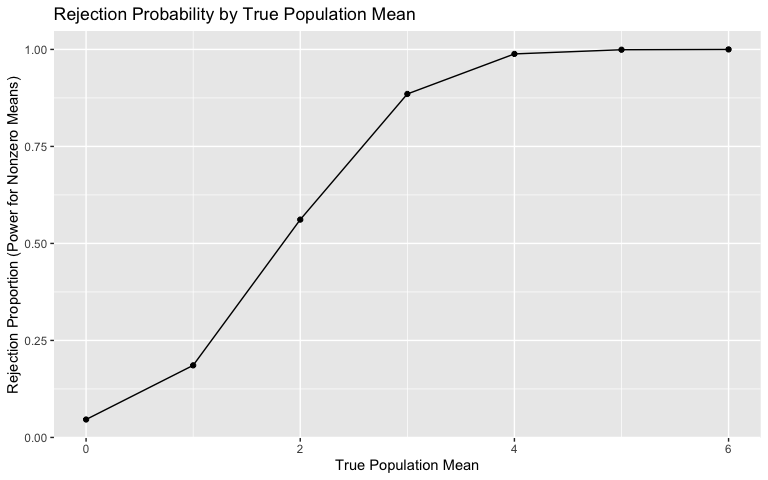
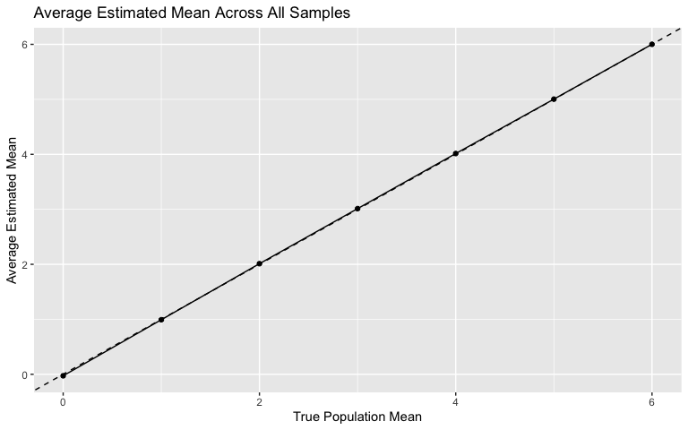
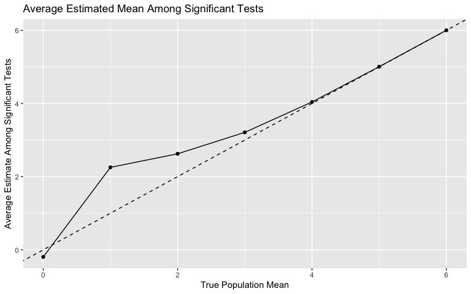

p8105_hw5_hyw2105
================
Irene Wen

## Problem 1 — Birthday Paradox Simulation

### Birthday Simulation Function

``` r
birthday_sim = function(n) {

  birthdays = sample(
    x = 1:365,
    size = n,
    replace = TRUE
  )

  shared_birthday = any(duplicated(birthdays))

  return(shared_birthday)
}
```

### Estimating the Shared Birthday Probability

``` r
birthday_prob = function(n) {

  sim_results = map_lgl(
    1:10000,
    \(i) birthday_sim(n = n)
  )

  estimated_prob = mean(sim_results)

  return(estimated_prob)
}
```

### Simulation Results Across Group Sizes

``` r
birthday_df =
  tibble(group_size = 2:50) |>
  mutate(
    probability = map_dbl(group_size, birthday_prob)
  )

birthday_df |>
  knitr::kable(digits = 3)
```

| group_size | probability |
|-----------:|------------:|
|          2 |       0.004 |
|          3 |       0.006 |
|          4 |       0.016 |
|          5 |       0.027 |
|          6 |       0.042 |
|          7 |       0.052 |
|          8 |       0.078 |
|          9 |       0.098 |
|         10 |       0.120 |
|         11 |       0.141 |
|         12 |       0.164 |
|         13 |       0.195 |
|         14 |       0.220 |
|         15 |       0.246 |
|         16 |       0.286 |
|         17 |       0.317 |
|         18 |       0.346 |
|         19 |       0.381 |
|         20 |       0.414 |
|         21 |       0.445 |
|         22 |       0.476 |
|         23 |       0.508 |
|         24 |       0.532 |
|         25 |       0.572 |
|         26 |       0.602 |
|         27 |       0.625 |
|         28 |       0.649 |
|         29 |       0.679 |
|         30 |       0.710 |
|         31 |       0.732 |
|         32 |       0.753 |
|         33 |       0.787 |
|         34 |       0.791 |
|         35 |       0.814 |
|         36 |       0.827 |
|         37 |       0.843 |
|         38 |       0.863 |
|         39 |       0.882 |
|         40 |       0.888 |
|         41 |       0.901 |
|         42 |       0.913 |
|         43 |       0.927 |
|         44 |       0.935 |
|         45 |       0.942 |
|         46 |       0.946 |
|         47 |       0.952 |
|         48 |       0.963 |
|         49 |       0.965 |
|         50 |       0.971 |

### Birthday Probability Plot

``` r
birthday_df |>
  ggplot(aes(x = group_size, y = probability)) +
  geom_line() +
  geom_point() +
  labs(
    title = "Probability of at Least Two People Sharing a Birthday",
    x = "Group Size",
    y = "Estimated Probability"
  )
```

<!-- -->

The estimated probability that at least two people share a birthday
generally increases with group size. The probability is only 0.4% for a
group of two people but rises to 50.8% for a group of 23 people and
reaches 97.1% for a group of 50 people. Although these results may
initially seem surprising, the number of possible pairs increases
rapidly as group size grows, making a shared birthday increasingly
likely.

## Problem 2 — Longitudinal Study and Spaghetti Plot

### Listing Study Files

``` r
subject_files =
  tibble(
    files = list.files(
      "data/",
      pattern = "\\.csv$"
    ),
    path = str_c("data/", files)
  )

subject_files |>
  knitr::kable()
```

| files      | path            |
|:-----------|:----------------|
| con_01.csv | data/con_01.csv |
| con_02.csv | data/con_02.csv |
| con_03.csv | data/con_03.csv |
| con_04.csv | data/con_04.csv |
| con_05.csv | data/con_05.csv |
| con_06.csv | data/con_06.csv |
| con_07.csv | data/con_07.csv |
| con_08.csv | data/con_08.csv |
| con_09.csv | data/con_09.csv |
| con_10.csv | data/con_10.csv |
| exp_01.csv | data/exp_01.csv |
| exp_02.csv | data/exp_02.csv |
| exp_03.csv | data/exp_03.csv |
| exp_04.csv | data/exp_04.csv |
| exp_05.csv | data/exp_05.csv |
| exp_06.csv | data/exp_06.csv |
| exp_07.csv | data/exp_07.csv |
| exp_08.csv | data/exp_08.csv |
| exp_09.csv | data/exp_09.csv |
| exp_10.csv | data/exp_10.csv |

### Importing and Combining CSV Files

``` r
subject_data =
  subject_files |>
  mutate(
    data = map(path, read_csv, show_col_types = FALSE)
  )

subject_data |>
  select(files, data)
```

    ## # A tibble: 20 × 2
    ##    files      data              
    ##    <chr>      <list>            
    ##  1 con_01.csv <spc_tbl_ [1 × 8]>
    ##  2 con_02.csv <spc_tbl_ [1 × 8]>
    ##  3 con_03.csv <spc_tbl_ [1 × 8]>
    ##  4 con_04.csv <spc_tbl_ [1 × 8]>
    ##  5 con_05.csv <spc_tbl_ [1 × 8]>
    ##  6 con_06.csv <spc_tbl_ [1 × 8]>
    ##  7 con_07.csv <spc_tbl_ [1 × 8]>
    ##  8 con_08.csv <spc_tbl_ [1 × 8]>
    ##  9 con_09.csv <spc_tbl_ [1 × 8]>
    ## 10 con_10.csv <spc_tbl_ [1 × 8]>
    ## 11 exp_01.csv <spc_tbl_ [1 × 8]>
    ## 12 exp_02.csv <spc_tbl_ [1 × 8]>
    ## 13 exp_03.csv <spc_tbl_ [1 × 8]>
    ## 14 exp_04.csv <spc_tbl_ [1 × 8]>
    ## 15 exp_05.csv <spc_tbl_ [1 × 8]>
    ## 16 exp_06.csv <spc_tbl_ [1 × 8]>
    ## 17 exp_07.csv <spc_tbl_ [1 × 8]>
    ## 18 exp_08.csv <spc_tbl_ [1 × 8]>
    ## 19 exp_09.csv <spc_tbl_ [1 × 8]>
    ## 20 exp_10.csv <spc_tbl_ [1 × 8]>

``` r
full_df =
  subject_data |>
  unnest(cols = data)

full_df |>
  select(files, week_1, week_8) |>
  head(6) |>
  knitr::kable(digits = 2)
```

| files      | week_1 | week_8 |
|:-----------|-------:|-------:|
| con_01.csv |   0.20 |   1.94 |
| con_02.csv |   1.13 |   0.44 |
| con_03.csv |   1.77 |   1.01 |
| con_04.csv |   1.04 |   1.66 |
| con_05.csv |   0.47 |   0.48 |
| con_06.csv |   2.37 |   2.35 |

### Reshaping to Tidy Longitudinal Data

``` r
tidy_df =
  full_df |>
  mutate(
    subj = str_remove(files, "\\.csv$"),
    arm = str_sub(subj, 1, 3),
    subject_id = str_sub(subj, 5)
  ) |>
  pivot_longer(
    cols = week_1:week_8,
    names_to = "week",
    values_to = "outcome",
    names_prefix = "week_"
  ) |>
  mutate(
    week = as.numeric(week)
  ) |>
  select(subject_id, arm, subj, week, outcome) |>
  arrange(subj, week)

tidy_df |>
  head(12) |>
  knitr::kable(digits = 2)
```

| subject_id | arm | subj   | week | outcome |
|:-----------|:----|:-------|-----:|--------:|
| 01         | con | con_01 |    1 |    0.20 |
| 01         | con | con_01 |    2 |   -1.31 |
| 01         | con | con_01 |    3 |    0.66 |
| 01         | con | con_01 |    4 |    1.96 |
| 01         | con | con_01 |    5 |    0.23 |
| 01         | con | con_01 |    6 |    1.09 |
| 01         | con | con_01 |    7 |    0.05 |
| 01         | con | con_01 |    8 |    1.94 |
| 02         | con | con_02 |    1 |    1.13 |
| 02         | con | con_02 |    2 |   -0.88 |
| 02         | con | con_02 |    3 |    1.07 |
| 02         | con | con_02 |    4 |    0.17 |

### Data Validation

``` r
nrow(tidy_df)
```

    ## [1] 160

``` r
tidy_df |>
  count(arm) |>
  knitr::kable()
```

| arm |   n |
|:----|----:|
| con |  80 |
| exp |  80 |

``` r
tidy_df |>
  group_by(subj) |>
  summarize(
    n_weeks = n(),
    .groups = "drop"
  ) |>
  knitr::kable()
```

| subj   | n_weeks |
|:-------|--------:|
| con_01 |       8 |
| con_02 |       8 |
| con_03 |       8 |
| con_04 |       8 |
| con_05 |       8 |
| con_06 |       8 |
| con_07 |       8 |
| con_08 |       8 |
| con_09 |       8 |
| con_10 |       8 |
| exp_01 |       8 |
| exp_02 |       8 |
| exp_03 |       8 |
| exp_04 |       8 |
| exp_05 |       8 |
| exp_06 |       8 |
| exp_07 |       8 |
| exp_08 |       8 |
| exp_09 |       8 |
| exp_10 |       8 |

### Spaghetti Plot

``` r
tidy_df |>
  ggplot(
    aes(
      x = week,
      y = outcome,
      group = subj,
      color = arm
    )
  ) +
  geom_point() +
  geom_path() +
  facet_grid(~ arm) +
  labs(
    title = "Longitudinal Outcomes by Study Arm",
    x = "Week",
    y = "Observed Outcome",
    color = "Study Arm"
  )
```

<!-- -->

### Weekly Mean Outcomes by Study Arm

``` r
week_summary =
  tidy_df |>
  group_by(arm, week) |>
  summarize(
    mean_outcome = mean(outcome),
    .groups = "drop"
  )

week_summary |>
  pivot_wider(
    names_from = arm,
    values_from = mean_outcome
  ) |>
  knitr::kable(digits = 3)
```

| week |   con |   exp |
|-----:|------:|------:|
|    1 | 0.915 | 1.141 |
|    2 | 1.152 | 2.599 |
|    3 | 1.185 | 3.135 |
|    4 | 1.104 | 3.770 |
|    5 | 1.282 | 3.806 |
|    6 | 0.771 | 4.550 |
|    7 | 0.990 | 5.017 |
|    8 | 0.740 | 5.119 |

The spaghetti plot shows different longitudinal patterns between the
control and experimental groups. Outcomes in the control group fluctuate
over time without a clear upward or downward trend, with the group mean
decreasing slightly from 0.915 at week 1 to 0.740 at week 8. In
contrast, the experimental group shows a clear overall upward trend,
with the mean outcome increasing from 1.141 to 5.119 over the same
period. Although individual trajectories vary within both groups, the
increase is more pronounced in the experimental group. These descriptive
findings suggest differences in longitudinal outcome patterns between
the two study arms, but the plot alone cannot establish a causal
treatment effect.

## Problem 3 — Statistical Power Simulation

### Simulation Function

``` r
sim_ttest = function(n, mu, sigma = 5) {

  sim_data =
    tibble(
      x = rnorm(
        n = n,
        mean = mu,
        sd = sigma
      )
    )

  test_result = t.test(
    sim_data |> pull(x),
    mu = 0
  )

  tidy_result =
    test_result |>
    broom::tidy() |>
    select(estimate, p.value)

  return(tidy_result)
}
```

### Simulation Results

``` r
simulation_results =
  expand_grid(
    true_mu = 0:6,
    iter = 1:5000
  ) |>
  mutate(
    result = map(
      true_mu,
      \(mu) sim_ttest(n = 30, mu = mu, sigma = 5)
    )
  ) |>
  unnest(cols = result) |>
  mutate(
    reject_null = p.value < 0.05
  )
```

### Statistical Power

``` r
power_df =
  simulation_results |>
  group_by(true_mu) |>
  summarize(
    power = mean(reject_null),
    .groups = "drop"
  )

power_df |>
  knitr::kable(digits = 3)
```

| true_mu | power |
|--------:|------:|
|       0 | 0.046 |
|       1 | 0.186 |
|       2 | 0.561 |
|       3 | 0.885 |
|       4 | 0.988 |
|       5 | 0.999 |
|       6 | 1.000 |

``` r
power_df |>
  ggplot(aes(x = true_mu, y = power)) +
  geom_line() +
  geom_point() +
  labs(
    title = "Rejection Probability by True Population Mean",
    x = "True Population Mean",
    y = "Rejection Proportion (Power for Nonzero Means)"
  )
```

<!-- -->

The rejection probability increases as the true population mean moves
farther from the null value of zero. With the sample size (n = 30) and
population standard deviation (sigma = 5) held constant, statistical
power increases with effect size. When the true mean is zero, the
rejection proportion is 0.046, close to the specified significance level
of 0.05. As the true mean increases from 1 to 3, statistical power rises
from 0.186 to 0.885, reaching 0.988 at a true mean of 4. For larger true
means (5 and 6), the estimated power approaches 1 (0.999 and 1.000),
indicating a very high probability of rejecting the null hypothesis when
it is false.

### Average Estimated Mean Across All Samples

``` r
all_estimates_df =
  simulation_results |>
  group_by(true_mu) |>
  summarize(
    avg_mu_hat = mean(estimate),
    .groups = "drop"
  )

all_estimates_df |>
  knitr::kable(digits = 3)
```

| true_mu | avg_mu_hat |
|--------:|-----------:|
|       0 |     -0.028 |
|       1 |      0.992 |
|       2 |      2.011 |
|       3 |      3.013 |
|       4 |      4.014 |
|       5 |      5.003 |
|       6 |      6.001 |

``` r
all_estimates_df |>
  ggplot(aes(x = true_mu, y = avg_mu_hat)) +
  geom_line() +
  geom_point() +
  geom_abline(
    intercept = 0,
    slope = 1,
    linetype = "dashed"
  ) +
  labs(
    title = "Average Estimated Mean Across All Samples",
    x = "True Population Mean",
    y = "Average Estimated Mean"
  )
```

<!-- -->

The average estimated population mean across all simulated samples
closely follows the true population mean. For example, when the true
mean is 1, the average estimate is 0.992, and when the true mean is 6,
the average estimate is 6.001. Across all seven groups, the estimates
lie very close to the reference line (y = x), with the largest absolute
difference from the true mean being only about 0.028 (at a true mean of
0).These findings are consistent with the unbiasedness of the sample
mean, while the small deviations from the true values can be attributed
to Monte Carlo variability from a finite number of simulations.

### Average Estimated Mean Among Significant Tests

``` r
significant_estimates_df =
  simulation_results |>
  filter(reject_null) |>
  group_by(true_mu) |>
  summarize(
    avg_mu_hat_significant = mean(estimate),
    n_significant = n(),
    .groups = "drop"
  )

significant_estimates_df |>
  knitr::kable(digits = 3)
```

| true_mu | avg_mu_hat_significant | n_significant |
|--------:|-----------------------:|--------------:|
|       0 |                 -0.195 |           231 |
|       1 |                  2.254 |           929 |
|       2 |                  2.625 |          2807 |
|       3 |                  3.210 |          4426 |
|       4 |                  4.040 |          4942 |
|       5 |                  5.006 |          4996 |
|       6 |                  6.001 |          5000 |

``` r
significant_estimates_df |>
  ggplot(
    aes(
      x = true_mu,
      y = avg_mu_hat_significant
    )
  ) +
  geom_line() +
  geom_point() +
  geom_abline(
    intercept = 0,
    slope = 1,
    linetype = "dashed"
  ) +
  labs(
    title = "Average Estimated Mean Among Significant Tests",
    x = "True Population Mean",
    y = "Average Estimate Among Significant Tests"
  )
```

<!-- -->

The average estimated mean among statistically significant tests is not
necessarily equal to the true population mean. For smaller positive
effect sizes, restricting the analysis to significant results tends to
select samples with unusually large observed effects. For example, when
the true mean is 1, the average estimate among significant tests is
2.254, compared with 0.992 across all samples. Similarly, when the true
mean is 2, the average estimate increases from 2.011 across all samples
to 2.625 among significant tests.

This pattern reflects selection bias introduced by conditioning on
statistical significance, rather than bias in the sample mean estimator
itself. When the true mean is zero, significant estimates can occur in
both directions, so their signed average may remain close to zero
(-0.195 in this simulation). As statistical power increases, nearly all
samples are retained, and the significant-only estimates become closer
to the true population means. When the true mean is 6, all 5,000
simulated tests are significant, resulting in the same average estimate
(6.001) for both the full sample and the significant-only sample.
